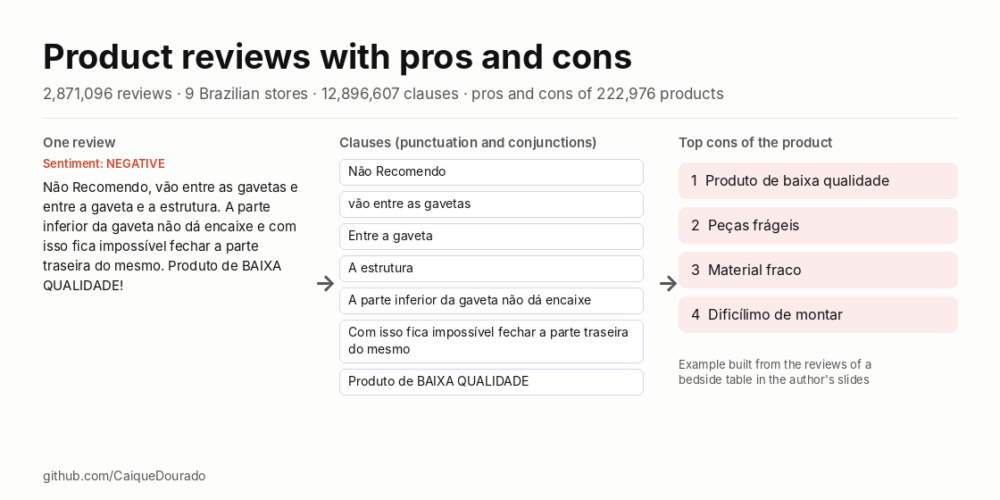
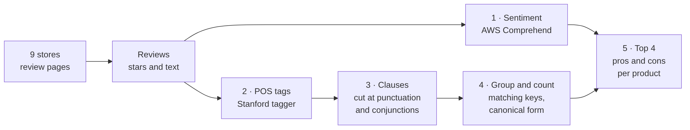
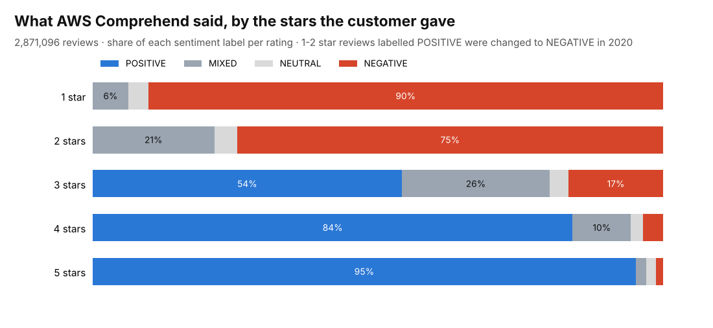

# Reviews de produtos (pt-BR) · Brazilian product reviews with pros and cons

[](https://github.com/CaiqueDourado/reviews-produtos-ptbr/actions/workflows/validate.yml)
[](LICENSE-DATA.md)
[](LICENSE)
[](https://www.kaggle.com/datasets/caiquedourado/reviews-produtos-ptbr)

[Leia em português](README.pt-BR.md)



2.87 million product reviews in Brazilian Portuguese from 9 stores, with the customer's stars, an AWS sentiment label, scores per aspect, and the 2020 pipeline that turned them into **pros and cons for 222,976 products**: 12.9 million clauses with part-of-speech tags, matching keys and a canonical form.

It is about 22 times the size of B2W-Reviews01, the best-known Portuguese review dataset, and it includes the intermediate steps of an opinion-summary pipeline that ran in production.

| File | Rows | What |
|---|---:|---|
| `reviews` | 2,871,096 | stars, recommendation, title, text, sentiment, helpfulness, dates, store |
| `sentences` | 12,896,607 | clauses with POS tags, six matching keys and canonical form |
| `aspect_ratings` | 2,484,634 | scores 1–5 for quality, design, battery, screen… |
| `pros_cons` | 922,402 | top 4 pros and 4 cons per product |
| `groups` | 235,712 | product name, review count and average stars |

The full files (Parquet) are on [Kaggle](https://www.kaggle.com/datasets/caiquedourado/reviews-produtos-ptbr). This repository has the scripts, the documentation and `sample/`: every row of 2,000 random products (21,939 reviews).

## How the pros and cons were made



From the author's 2020 presentation, *"Divisão de Sentenças + Análise de sentimentos = Prós e Contras"*:

1. **Sentiment of each review.** AWS Comprehend labels the whole text POSITIVE, NEGATIVE, NEUTRAL or MIXED. Reviews labelled POSITIVE with 1–2 stars were changed to NEGATIVE.
2. **Tag every word.** The Stanford POS tagger (Portuguese model): `não/ADV Recomendo/VERB …`. Google Cloud Natural Language did this first and was dropped in January 2020 as too expensive.
3. **Cut into clauses** at punctuation and conjunctions, keeping *que, se, como, quando, quanto, enquanto, apenas* inside:

   > Não Recomendo, vão entre as gavetas e entre a gaveta e a estrutura. A parte inferior da gaveta não dá encaixe e com isso fica impossível fechar a parte traseira do mesmo. Produto de BAIXA QUALIDADE!

   → *Não Recomendo* · *vão entre as gavetas* · *Entre a gaveta* · *A estrutura* · *A parte inferior da gaveta não dá encaixe* · *Com isso fica impossível fechar a parte traseira do mesmo* · *Produto de BAIXA QUALIDADE*
4. **Group and count.** Inside each product, clauses that share a phonetic or fingerprint key get one canonical spelling ("Otimo produto", "Ótimo produto!" → one).
5. **Show the top 4** canonical clauses of the POSITIVE reviews as pros and of the NEGATIVE reviews as cons.

Two products of the sample, with their pros and cons as computed (`pros_cons` joined with `groups`):

**Notebook Samsung Expert X23** (group 789660, 1,947 reviews, 4.32 stars)

| Pros | mentions | Cons | mentions |
|---|---:|---|---:|
| Muito bom | 55 | Nao recomendo | 3 |
| Produto muito bom | 54 | Muito lento | 3 |
| Otimo produto | 47 | A entrega foi bem rápida | 2 |
| Entrega rápida | 36 | Me arrependi | 2 |

**Smartphone Samsung Galaxy Gran 2 Duos** (group 725383, 801 reviews, 3.17 stars): pros *Muito bom · Fácil de usar · Ela adorou · Entrega rápida*; cons *Nao recomendo · Veio com defeito · Péssimo produto · Trava muito*.

"A entrega foi bem rápida" among the notebook's cons shows the method's main limit: sentiment is per review, so every clause of a negative review counts against the product. The [data quality report](docs/data-quality.md) covers this and the others. The [pros-e-contras-ptbr](https://github.com/CaiqueDourado/pros-e-contras-ptbr) library scores each clause instead: on 51 held-out products, right cons go from 64.7% to 89.7% ([article](https://github.com/CaiqueDourado/pros-e-contras-ptbr/blob/main/docs/article-pros-and-cons.md)).

## Sentiment against stars



AWS Comprehend agrees with the stars at the ends and splits in the middle: 3-star reviews are 54% POSITIVE, and 20,642 five-star reviews are NEGATIVE ("customers complain but don't want to give a bad grade", in the author's 2020 notes).

## Use it

```python
import pandas as pd

reviews = pd.read_csv("sample/reviews_sample.csv", parse_dates=["submitted_at"])
pros_cons = pd.read_csv("sample/pros_cons_sample.csv")

reviews.groupby("store")["rating"].agg(["count", "mean"]).round(2)
groups = pd.read_csv("sample/groups_sample.csv")
pros_cons.merge(groups, on="group_id").query("group_id == 789660")
```

```sql
-- DuckDB, full files from Kaggle: aspects that drag down the average
SELECT aspect, count(*) AS scores, round(avg(score), 2) AS avg_score
FROM 'aspect_ratings.parquet' GROUP BY aspect HAVING count(*) > 1000 ORDER BY avg_score;
```

`product_id` and `group_id` join with the [catalog dataset](https://github.com/CaiqueDourado/catalogo-produtos-ecommerce-brasil) (prices, specifications, EANs, categories).

## Where the reviews came from

The collection started in 2017 for **É bom? Vale a pena?** ([opiniaobomvaleapena.com.br, archived](https://web.archive.org/web/2022/https://opiniaobomvaleapena.com.br/)), a WordPress site with one page per product ("<produto> é bom? vale a pena?"), its reviews, and affiliate links to the stores. Most stores served their reviews through Bazaarvoice's JSON API; Casas Bahia, Extra and Ponto Frio through Via Varejo's own. The collection then moved to the author's crawler and data lake, where each review was linked to the store offer and to the product group, so one product's reviews from all stores could be read together, and where the pros and cons were computed for the product pages of the author's sites. Details: [methodology](docs/methodology.md). The site's story: [case study](docs/case-study-e-bom-vale-a-pena.md).

## Privacy and cleaning

- Nicknames, cities, author ids and review ids were never exported.
- E-mails, phone numbers and CPF-like numbers in the texts are masked (`[e-mail]`, `[telefone]`, `[cpf]`).
- Store names had already been replaced by "loja" in 2020.
- About 28% of the texts had lost every ã/õ in collection ("nao", "funçao") while keeping other accents; those words were restored from the spelling seen in intact texts ("não", "função"), and `text_original` keeps what was collected.

Every column: [data dictionary](docs/data-dictionary.md) ([pt-BR](docs/data-dictionary.pt-BR.md)).

## Repository layout

```text
sample/        every row of 2,000 products: reviews, sentences, aspect_ratings, pros_cons, groups (CSV)
schema/        column definitions and dataset metadata
scripts/       exportar_reviews.py (SQL Server → Parquet), perfil_reviews.py, build_reviews.py, nomes_grupos.py,
               validate.py, docs.py, make_figures.py
notebooks/     eda.ipynb
docs/          data dictionary, methodology, data quality, Kaggle description, images
kaggle/        dataset-metadata.json
stats.json     counts of every build step
```

## Related

- [pros-e-contras-ptbr](https://github.com/CaiqueDourado/pros-e-contras-ptbr): the 2020 method as a Python library, plus clause-level sentiment. Articles: [clause splitting](https://github.com/CaiqueDourado/pros-e-contras-ptbr/blob/main/docs/article-clause-splitting.md) (Google Cloud NL × Stanford × rules) and [pros and cons](https://github.com/CaiqueDourado/pros-e-contras-ptbr/blob/main/docs/article-pros-and-cons.md).
- [Case study: É bom? Vale a pena?](docs/case-study-e-bom-vale-a-pena.md): the review site this data was collected for.
- [catalogo-produtos-ecommerce-brasil](https://github.com/CaiqueDourado/catalogo-produtos-ecommerce-brasil): the products these reviews belong to.
- [DedupKit](https://github.com/CaiqueDourado/DedupKit): the matching keys, with the fingerprint bug fixed.
- [nomes-e-sobrenomes-brasil](https://github.com/CaiqueDourado/nomes-e-sobrenomes-brasil): the same keys applied to names.

## License

The compilation and the derived columns are [CC BY 4.0](LICENSE-DATA.md); review texts belong to their authors. Code: [MIT](LICENSE). Removal requests: open an issue.

## Author

**Caique Dourado**: 20 years building crawlers, data pipelines and programmatic SEO in .NET and SQL Server. More at [github.com/CaiqueDourado](https://github.com/CaiqueDourado).
