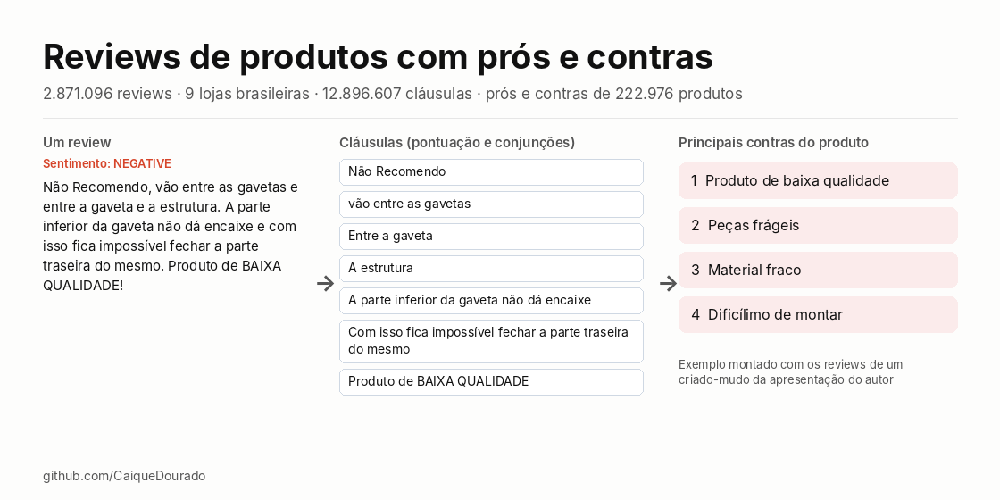
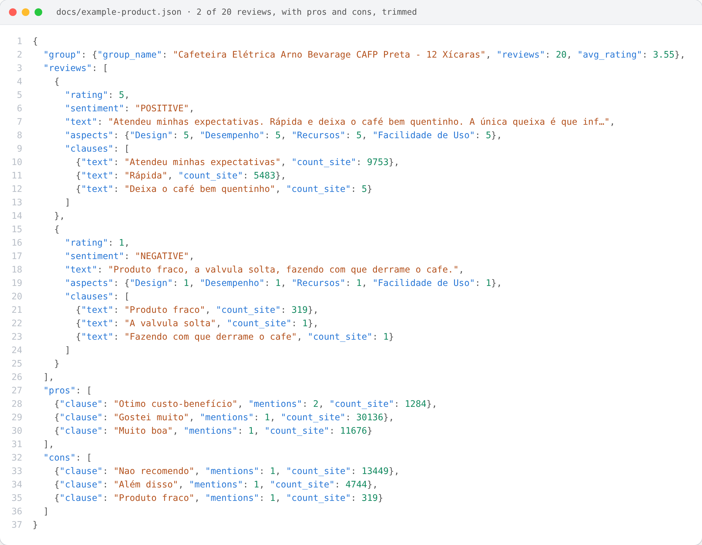
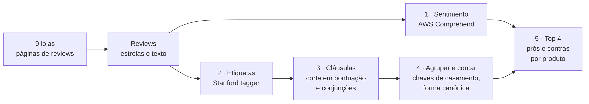
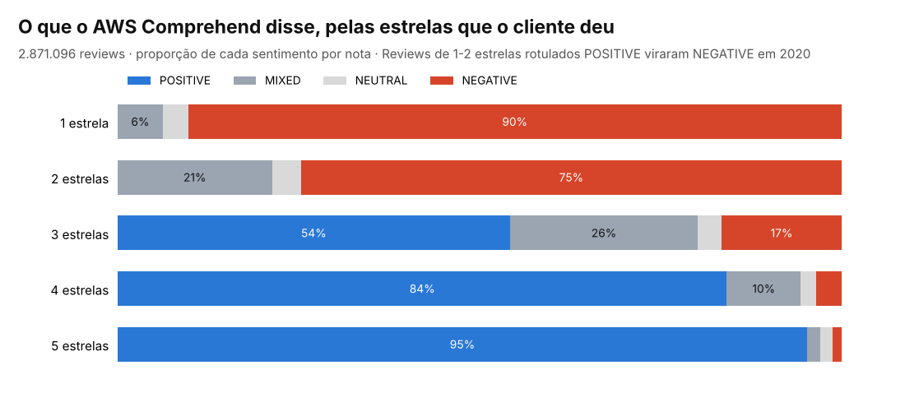

# Reviews de produtos (pt-BR) com prós e contras

[](https://github.com/CaiqueDourado/portuguese-product-reviews/actions/workflows/validate.yml)
[](LICENSE-DATA.md)
[](LICENSE)
[](https://www.kaggle.com/datasets/caiquedourado/reviews-produtos-ptbr)
[](https://www.kaggle.com/code/caiquedourado/notebook-reviews-produtos-ptbr)

[Read in English](README.md)



São 2,87 milhões de reviews de produtos em português, de 9 lojas brasileiras. Cada um traz as estrelas do cliente, um rótulo de sentimento da AWS e notas por aspecto. Junto vai o pipeline de 2020 que transformou esses reviews em **prós e contras de 222.976 produtos**: 12,9 milhões de cláusulas com etiquetas gramaticais, chaves de casamento e forma canônica.

A base é cerca de 22 vezes maior que a B2W-Reviews01, a base de reviews em português mais conhecida. E traz os passos intermediários de um resumo de opiniões que rodou em produção.

| Arquivo | Linhas | O que tem |
|---|---:|---|
| `reviews` | 2.871.096 | estrelas, recomendação, título, texto, sentimento, utilidade, datas, loja |
| `sentences` | 12.896.607 | cláusulas com etiquetas, seis chaves de casamento e forma canônica |
| `aspect_ratings` | 2.484.634 | notas de 1 a 5 para qualidade, design, bateria, tela… |
| `pros_cons` | 922.402 | os 4 prós e 4 contras de cada produto |
| `groups` | 235.712 | nome do produto, quantidade de reviews e média de estrelas |

Os arquivos completos (Parquet) estão no [Kaggle](https://www.kaggle.com/datasets/caiquedourado/reviews-produtos-ptbr). Este repositório tem os scripts, a documentação e a pasta `sample/`, com todas as linhas de 2.000 produtos sorteados (21.939 reviews).

## Como um produto é estruturado



Um produto de `sample/` em JSON aninhado: o grupo 2679579, uma cafeteira elétrica Arno com 20 reviews e média de 3,55 estrelas. Cada review traz as estrelas, o sentimento da AWS, as notas por aspecto e as cláusulas em que foi cortado, com quantas vezes cada cláusula aparece no site inteiro (`count_site`); os 4 prós e 4 contras do produto saem dessas cláusulas. Registro completo: [docs/example-product.json](docs/example-product.json), gerado por [scripts/make_json.py](scripts/make_json.py).

## Como os prós e contras foram feitos



Os passos seguem a apresentação do autor, *"Divisão de Sentenças + Análise de sentimentos = Prós e Contras"*:

1. **Sentimento de cada review.** O AWS Comprehend rotula o texto inteiro como POSITIVE, NEGATIVE, NEUTRAL ou MIXED. Reviews POSITIVE com 1 ou 2 estrelas viraram NEGATIVE.
2. **Etiqueta de cada palavra.** É feita pelo Stanford POS Tagger, com um modelo em português: `não/ADV Recomendo/VERB …`. O Google Cloud Natural Language fazia isso antes e foi trocado em janeiro de 2020, por ser caro demais.
3. **Corte em cláusulas** na pontuação e nas conjunções. *Que, se, como, quando, quanto, enquanto* e *apenas* ficam dentro da cláusula:

   > Não Recomendo, vão entre as gavetas e entre a gaveta e a estrutura. A parte inferior da gaveta não dá encaixe e com isso fica impossível fechar a parte traseira do mesmo. Produto de BAIXA QUALIDADE!

   → *Não Recomendo* · *vão entre as gavetas* · *Entre a gaveta* · *A estrutura* · *A parte inferior da gaveta não dá encaixe* · *Com isso fica impossível fechar a parte traseira do mesmo* · *Produto de BAIXA QUALIDADE*
4. **Agrupar e contar.** Dentro de cada produto, cláusulas que têm uma chave fonética ou de fingerprint em comum ganham uma grafia canônica: "Otimo produto" e "Ótimo produto!" viram uma só.
5. **Mostrar as 4 mais citadas.** As cláusulas canônicas dos reviews POSITIVE viram prós, e as dos NEGATIVE viram contras.

Dois produtos da amostra, com os prós e contras como foram calculados (`pros_cons` ligado a `groups`):

**Notebook Samsung Expert X23** (grupo 789660, 1.947 reviews, 4,32 estrelas)

| Prós | menções | Contras | menções |
|---|---:|---|---:|
| Muito bom | 55 | Nao recomendo | 3 |
| Produto muito bom | 54 | Muito lento | 3 |
| Otimo produto | 47 | A entrega foi bem rápida | 2 |
| Entrega rápida | 36 | Me arrependi | 2 |

**Smartphone Samsung Galaxy Gran 2 Duos** (grupo 725383, 801 reviews, 3,17 estrelas): prós *Muito bom · Fácil de usar · Ela adorou · Entrega rápida*; contras *Nao recomendo · Veio com defeito · Péssimo produto · Trava muito*.

"A entrega foi bem rápida" entre os contras do notebook mostra o principal limite do método. O sentimento é do review inteiro, então toda cláusula de um review negativo conta contra o produto. O [relatório de qualidade](docs/data-quality.md) trata deste e dos outros limites. A biblioteca [pros-e-contras-ptbr](https://github.com/CaiqueDourado/pros-e-contras-ptbr) dá uma nota a cada cláusula: em 51 produtos separados para teste, os contras certos sobem de 64,7% para 89,7% ([artigo](https://github.com/CaiqueDourado/pros-e-contras-ptbr/blob/main/docs/artigo-pros-e-contras.md)).

## Sentimento × estrelas



O AWS Comprehend concorda com as estrelas nas pontas e se divide no meio. Os reviews de 3 estrelas são 54% POSITIVE. Há 20.642 reviews de 5 estrelas rotulados NEGATIVE. Nas anotações de 2020, o autor explica: "clientes falam negativo, mas têm pena de dar nota ruim".

## Como usar

```python
import pandas as pd

reviews = pd.read_csv("sample/reviews_sample.csv", parse_dates=["submitted_at"])
pros_cons = pd.read_csv("sample/pros_cons_sample.csv")

reviews.groupby("store")["rating"].agg(["count", "mean"]).round(2)
groups = pd.read_csv("sample/groups_sample.csv")
pros_cons.merge(groups, on="group_id").query("group_id == 789660")
```

```sql
-- DuckDB, arquivos completos do Kaggle: aspectos que puxam a nota para baixo
SELECT aspect, count(*) AS notas, round(avg(score), 2) AS media
FROM 'aspect_ratings.parquet' GROUP BY aspect HAVING count(*) > 1000 ORDER BY media;
```

`product_id` e `group_id` ligam com a [base do catálogo](https://github.com/CaiqueDourado/brazilian-ecommerce-products), que traz preços, ficha técnica, EANs e categorias.

## De onde vieram os reviews

A coleta começou em 2017 para o **É bom? Vale a pena?** ([opiniaobomvaleapena.com.br, arquivado](https://web.archive.org/web/20230106180533/https://opiniaobomvaleapena.com.br/)). Era um site em WordPress com uma página por produto ("<produto> é bom? vale a pena?"), os reviews desse produto e links de afiliado para as lojas. A maioria das lojas entregava os reviews pela API em JSON da Bazaarvoice. Casas Bahia, Extra e Ponto Frio entregavam pela API própria da Via Varejo.

Depois, a coleta passou para o crawler e o data lake do autor. Lá, cada review foi ligado à oferta da loja e ao grupo de produto, para que os reviews de um produto em todas as lojas fossem lidos juntos. Foi também no data lake que os prós e contras foram calculados, para as páginas de produto dos sites do autor. Detalhes na [metodologia](docs/methodology.md) (em inglês). A história do site está no [estudo de caso](docs/estudo-de-caso-e-bom-vale-a-pena.md).

[](https://web.archive.org/web/20251021032358/https://tudosobreprodutos.com.br/tudo-sobre-bebedouro-cadence-pure-vita-elegant-0v)

*Tudo Sobre Produtos (2020), um dos sites do autor cujas páginas de produto mostravam estes reviews e seus prós e contras. [Arquivado no Wayback Machine](https://web.archive.org/web/20251021032358/https://tudosobreprodutos.com.br/tudo-sobre-bebedouro-cadence-pure-vita-elegant-0v).*

## Privacidade e limpeza

- Apelido, cidade, id do autor e ids do review nunca foram exportados.
- E-mails, telefones e números com formato de CPF nos textos foram mascarados (`[e-mail]`, `[telefone]`, `[cpf]`).
- Os nomes de lojas já tinham sido trocados por "loja" em 2020.
- Cerca de 28% dos textos perderam todos os ã/õ na coleta ("nao", "funçao"), mas mantiveram os outros acentos. Essas palavras foram restauradas pela grafia vista nos textos intactos ("não", "função"), e `text_original` guarda o que foi coletado.

Cada coluna está no [dicionário de dados](docs/data-dictionary.pt-BR.md) ([EN](docs/data-dictionary.md)).

## Estrutura do repositório

```text
sample/        todas as linhas de 2.000 produtos: reviews, sentences, aspect_ratings, pros_cons, groups (CSV)
schema/        definição das colunas e metadados
scripts/       exportar_reviews.py (SQL Server → Parquet), perfil_reviews.py, build_reviews.py, nomes_grupos.py,
               validate.py, docs.py, make_figures.py
notebooks/     eda.ipynb (também no Kaggle: https://www.kaggle.com/code/caiquedourado/notebook-reviews-produtos-ptbr)
docs/          dicionário de dados, metodologia, qualidade, descrição do Kaggle, imagens
kaggle/        dataset-metadata.json
stats.json     contagens de cada etapa do build
```

## Relacionados

- Artigo: [Divisão de sentenças + análise de sentimentos = prós e contras](https://github.com/CaiqueDourado/articles/blob/main/pros-and-cons/README.pt-BR.md): como as cláusulas e os prós e contras destas avaliações foram feitos, e corrigidos.
- [pros-e-contras-ptbr](https://github.com/CaiqueDourado/pros-e-contras-ptbr): o método de 2020 como biblioteca Python, com sentimento por cláusula. Artigos: [divisão em cláusulas](https://github.com/CaiqueDourado/pros-e-contras-ptbr/blob/main/docs/artigo-divisao-de-clausulas.md) (Google Cloud NL × Stanford × regras) e [prós e contras](https://github.com/CaiqueDourado/pros-e-contras-ptbr/blob/main/docs/artigo-pros-e-contras.md).
- [Estudo de caso: É bom? Vale a pena?](docs/estudo-de-caso-e-bom-vale-a-pena.md): o site para o qual estes dados foram coletados.
- [brazilian-ecommerce-products](https://github.com/CaiqueDourado/brazilian-ecommerce-products): os produtos a que estes reviews pertencem.
- [lojas-virtuais-brasil](https://github.com/CaiqueDourado/lojas-virtuais-brasil): 63.974 lojas virtuais brasileiras com plataforma e reputação no Reclame Aqui ([Kaggle](https://www.kaggle.com/datasets/caiquedourado/lojas-virtuais-brasil)).
- [DedupKit](https://github.com/CaiqueDourado/DedupKit): as chaves de casamento, com o bug do fingerprint corrigido.
- [brazilian-names-surnames](https://github.com/CaiqueDourado/brazilian-names-surnames): as mesmas chaves aplicadas a nomes.

## Licença

A compilação e as colunas derivadas estão em [CC BY 4.0](LICENSE-DATA.md); os textos dos reviews pertencem a seus autores. Código: [MIT](LICENSE). Pedidos de remoção: abra uma issue.

## Autor

**Caique Dourado**: 20 anos construindo crawlers, pipelines de dados e SEO programático em .NET e SQL Server. Mais em [github.com/CaiqueDourado](https://github.com/CaiqueDourado).
