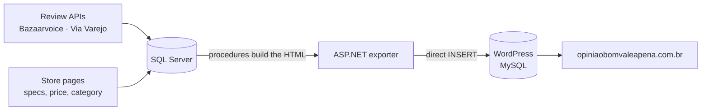

# Case study: É bom? Vale a pena?

[Leia em português](estudo-de-caso-e-bom-vale-a-pena.md)

*opiniaobomvaleapena.com.br, 2017–2022 · [Web Archive copy](https://web.archive.org/web/20230106180533/https://opiniaobomvaleapena.com.br/)*

## The idea

Before buying, Brazilians search "<produto> é bom?" ("is it good?") or "vale a pena?" ("is it worth it?"). The answers were scattered across store pages, one store at a time. **É bom? Vale a pena?** gathered on one page per product what buyers said in several stores. The page had the title people searched for and links to buy.

## What a page looked like

- **Title:** "<produto> é bom? Vale a pena?". The address was `/<produto>-e-bom-vale-a-pena`.
- **"Opiniões de quem comprou":** the stores' reviews, marked up with schema.org/Review.
- **"Onde encontrar?":** price and link per store, repeated every 25 reviews. The links were affiliate links (B2W, AWIN, Lomadee and Amazon programs).
- **Questions and answers** generated from the specifications: each attribute became a question.
- **Related products**, plus category pages built from the stores' category trees.

## How the data arrived

1. **Reviews.** They came from Bazaarvoice's JSON API for Americanas, Submarino and Shoptime, and from Via Varejo's own API for Casas Bahia, Ponto Frio and Extra. Collection was incremental: it stopped at the first review already stored.
2. **Specs, prices and categories.** They came from the store pages. Offers were matched across stores by EAN.
3. **Publishing.**
   - Stored procedures built each page's HTML.
   - An ASP.NET page wrote it straight into the WordPress tables, without the REST API.
   - Then came cache warm-up, a Cloudflare purge and the sitemaps.

## Numbers

| | |
|---|---|
| Reviews in the site's database | about 2.08 million (Americanas 990k, Submarino 592k, Shoptime 232k, Casas Bahia 151k, Extra 75k, Ponto Frio 45k) |
| WordPress pages (2020) | about 69,000 |
| Sitemaps | 139 in July 2017; 504 in October 2020 |
| Database and site (Feb 2020) | 9.9 GB and 14.3 GB |

The project files have no traffic or revenue records, so this case study gives no numbers on those.

## What came next

The site's collector became the starting point of the author's later crawler and data lake:

- It covered 3 more stores: Magazine Luiza, Fast Shop and Leroy Merlin.
- Each review was linked to the product **group**, so one product's reviews from all stores could be read together.
- The API capped the offset at 300,000 results. To get around that, searches were split by letter pairs.

The opinion summary changed too:

1. At first, topics were counted by hand in SQL ("Gostei", "Não gostei").
2. In 2020 came the **pros and cons** pipeline:
   - AWS Comprehend gave the sentiment of each review.
   - A POS tagger cut the text into clauses.
   - The 4 most repeated clauses on each side were shown.

That summary went to the product pages and Web Stories of the author's other sites. In 2022, É bom? Vale a pena? itself joined the data lake as one more project.

## Lessons

- **One page per real question works as an SEO structure**, but the page count grows faster than the ability to keep each page right. There were pages without a meta description, a wrong currency in the microdata, and stock that was always "InStock".
- **Keep history.** Prices and stock were overwritten. Write errors were swallowed silently. About 28% of the texts lost "ã" and "õ" during collection, and that only showed up years later, when the data was being published.
- **A whole-review sentiment label cannot separate pros from cons.** A negative review still praises the delivery. That limit led to the [pros-e-contras-ptbr](https://github.com/CaiqueDourado/pros-e-contras-ptbr) library, which scores each clause.

## Data and code

- [reviews-produtos-ptbr](https://github.com/CaiqueDourado/reviews-produtos-ptbr) ([Kaggle](https://www.kaggle.com/datasets/caiquedourado/reviews-produtos-ptbr)): 2.87 million reviews, clauses, and pros and cons.
- [pros-e-contras-ptbr](https://github.com/CaiqueDourado/pros-e-contras-ptbr): the 2020 method plus clause-level polarity.
- [catalogo-produtos-ecommerce-brasil](https://github.com/CaiqueDourado/catalogo-produtos-ecommerce-brasil): the products and groups.
