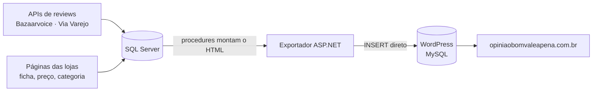

# Estudo de caso: É bom? Vale a pena?

[Read in English](case-study-e-bom-vale-a-pena.md)

*opiniaobomvaleapena.com.br, 2017 a 2022 · [cópia no Web Archive](https://web.archive.org/web/20230106180533/https://opiniaobomvaleapena.com.br/)*

## A ideia

Antes de comprar, muita gente digita no Google "<produto> é bom?" ou "vale a pena?". As respostas estavam espalhadas nas páginas das lojas, uma loja de cada vez. O **É bom? Vale a pena?** juntava, numa página por produto, as opiniões de quem comprou em várias lojas. A página tinha o título que a pessoa buscava e os links para comprar.

## Como era uma página

- **Título:** "<produto> é bom? Vale a pena?". O endereço era `/<produto>-e-bom-vale-a-pena`.
- **"Opiniões de quem comprou":** os reviews das lojas, marcados com schema.org/Review.
- **"Onde encontrar?":** preço e link de cada loja, repetidos a cada 25 reviews. Os links eram de afiliado (programas da B2W, AWIN, Lomadee e Amazon).
- **"Perguntas e respostas":** geradas a partir da ficha técnica. Cada característica do produto virava uma pergunta.
- **Produtos relacionados**, além das páginas de categoria montadas a partir da árvore de categorias das lojas.

## Como os dados chegavam

1. **Reviews.** Vinham da API JSON da Bazaarvoice para Americanas, Submarino e Shoptime, e da API própria da Via Varejo para Casas Bahia, Ponto Frio e Extra. A coleta era incremental: parava no primeiro review que já estava gravado.
2. **Ficha, preço e categoria.** Vinham das páginas das lojas. O casamento entre as lojas era feito pelo EAN.
3. **Publicação.**
   - Procedures no SQL Server montavam o HTML de cada página.
   - Uma página ASP.NET gravava o resultado direto nas tabelas do WordPress, sem a API REST.
   - Em seguida vinham o aquecimento de cache, a limpeza da Cloudflare e os sitemaps.

## Números

| | |
|---|---|
| Reviews no banco do site | cerca de 2,08 milhões (Americanas 990 mil, Submarino 592 mil, Shoptime 232 mil, Casas Bahia 151 mil, Extra 75 mil, Ponto Frio 45 mil) |
| Páginas no WordPress (2020) | cerca de 69 mil |
| Sitemaps | 139 em julho de 2017; 504 em outubro de 2020 |
| Banco e site (fev/2020) | 9,9 GB e 14,3 GB |

Não há registro de tráfego nem de receita nos arquivos do projeto, então este estudo não dá números sobre isso.

## O que veio depois

O coletor do site virou o ponto de partida do crawler e do data lake que vieram depois:

- O data lake passou a cobrir mais 3 lojas: Magazine Luiza, Fast Shop e Leroy Merlin.
- Cada review foi ligado ao **grupo** do produto, o que permite ler juntos os reviews de todas as lojas.
- A API limitava o offset a 300 mil resultados. Para contornar isso, a busca era dividida por pares de letras.

O resumo das opiniões também mudou:

1. No começo, os tópicos eram contados à mão em SQL ("Gostei", "Não gostei").
2. Em 2020 veio o pipeline de **prós e contras**: o sentimento de cada review vinha do AWS Comprehend, o texto era cortado em cláusulas com um POS tagger, e as 4 frases mais repetidas de cada lado eram exibidas.

Esse resumo foi para as páginas de produto e as Web Stories dos outros sites do autor. Em 2022, o próprio É bom? Vale a pena? entrou no data lake como mais um projeto.

## O que aprendi

- **Uma página por pergunta real funciona como estrutura de SEO.** Mas o volume de páginas cresce mais rápido que a capacidade de manter cada uma correta. Houve páginas sem meta description, moeda errada no microdata e estoque sempre "InStock".
- **Guardar o histórico.** Preço e estoque eram sobrescritos. Erros de gravação eram engolidos em silêncio. Cerca de 28% dos textos perderam o "ã" e o "õ" na coleta, e isso só apareceu anos depois, na hora de publicar a base.
- **O sentimento do review inteiro não basta para separar prós de contras.** Um review negativo também elogia a entrega. Esse limite levou à biblioteca [pros-e-contras-ptbr](https://github.com/CaiqueDourado/pros-e-contras-ptbr), que dá a polaridade de cada cláusula.

## Onde estão os dados e o código

- [portuguese-product-reviews](https://github.com/CaiqueDourado/portuguese-product-reviews) ([Kaggle](https://www.kaggle.com/datasets/caiquedourado/reviews-produtos-ptbr)): 2,87 milhões de reviews, cláusulas e prós e contras.
- [pros-e-contras-ptbr](https://github.com/CaiqueDourado/pros-e-contras-ptbr): o método de 2020 e a versão com polaridade por cláusula.
- [brazilian-ecommerce-products](https://github.com/CaiqueDourado/brazilian-ecommerce-products): os produtos e os grupos.
